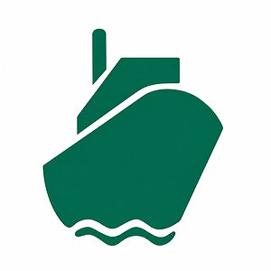

# Logos de empresas

Esta carpeta reúne los logos de las empresas que aparecen en los dashboards de Grafana.

Para usar un logo en un panel, abrí su archivo en GitHub y copiá la URL de la vista **Raw**. Cuando agregues una empresa, incluí su logo en esta carpeta y registrá la fuente en la tabla.

| Empresa | Logo | Archivo | URL para Grafana | Fuente |
|---|---|---|---|---|
| ADM |  | [adm.svg](./adm.svg) | [SVG directo](https://raw.githubusercontent.com/ParksIngDev/Grafana-Library/main/logos/adm.svg) | [Wikimedia Commons](https://commons.wikimedia.org/wiki/File:Archer_Daniels_Midland_logo.svg) |
| LDC (Lógico) |  | [ldc.svg](./ldc.svg) | [SVG directo](https://raw.githubusercontent.com/ParksIngDev/Grafana-Library/main/logos/ldc.svg) | — |
| ADM |  | [adm.png](./adm.png) | [PNG directo](https://raw.githubusercontent.com/ParksIngDev/Grafana-Library/main/logos/adm.png) | Archivo aportado |
| CARGILL |  | [cargill.jpg](./cargill.jpg) | [JPG directo](https://raw.githubusercontent.com/ParksIngDev/Grafana-Library/main/logos/cargill.jpg) | Archivo aportado |
| CARGO LINE |  | [cargo-line.jpg](./cargo-line.jpg) | [JPG directo](https://raw.githubusercontent.com/ParksIngDev/Grafana-Library/main/logos/cargo-line.jpg) | Archivo aportado |
| COPANU SA |  | [copanu-sa.jpg](./copanu-sa.jpg) | [JPG directo](https://raw.githubusercontent.com/ParksIngDev/Grafana-Library/main/logos/copanu-sa.jpg) | Archivo aportado |
| GIRONA |  | [girona.png](./girona.png) | [PNG directo](https://raw.githubusercontent.com/ParksIngDev/Grafana-Library/main/logos/girona.png) | Archivo aportado |
| GUARANFEEDER |  | [guaranfeeder.png](./guaranfeeder.png) | [PNG directo](https://raw.githubusercontent.com/ParksIngDev/Grafana-Library/main/logos/guaranfeeder.png) | Archivo aportado |
| IMPALA TERMINALS |  | [impala-terminals.jpg](./impala-terminals.jpg) | [JPG directo](https://raw.githubusercontent.com/ParksIngDev/Grafana-Library/main/logos/impala-terminals.jpg) | Archivo aportado |
| ISL |  | [isl.jpg](./isl.jpg) | [JPG directo](https://raw.githubusercontent.com/ParksIngDev/Grafana-Library/main/logos/isl.jpg) | Archivo aportado |
| LHG MINING |  | [lhg-mining.png](./lhg-mining.png) | [PNG directo](https://raw.githubusercontent.com/ParksIngDev/Grafana-Library/main/logos/lhg-mining.png) | Archivo aportado |
| LOGICO |  | [logico.jpg](./logico.jpg) | [JPG directo](https://raw.githubusercontent.com/ParksIngDev/Grafana-Library/main/logos/logico.jpg) | Archivo aportado |
| LPG |  | [lpg.jpg](./lpg.jpg) | [JPG directo](https://raw.githubusercontent.com/ParksIngDev/Grafana-Library/main/logos/lpg.jpg) | Archivo aportado |
| NAVEMAR SA |  | [navemar-sa.jpg](./navemar-sa.jpg) | [JPG directo](https://raw.githubusercontent.com/ParksIngDev/Grafana-Library/main/logos/navemar-sa.jpg) | Archivo aportado |
| P&O MARITIME |  | [p-o-maritime.jpg](./p-o-maritime.jpg) | [JPG directo](https://raw.githubusercontent.com/ParksIngDev/Grafana-Library/main/logos/p-o-maritime.jpg) | Archivo aportado |
| ROCKTREE (UABL) |  | [rocktree-uabl.jpg](./rocktree-uabl.jpg) | [JPG directo](https://raw.githubusercontent.com/ParksIngDev/Grafana-Library/main/logos/rocktree-uabl.jpg) | Archivo aportado |
| TRANSMAR |  | [transmar.jpg](./transmar.jpg) | [JPG directo](https://raw.githubusercontent.com/ParksIngDev/Grafana-Library/main/logos/transmar.jpg) | Archivo aportado |

Cada marca pertenece a su respectivo titular.
