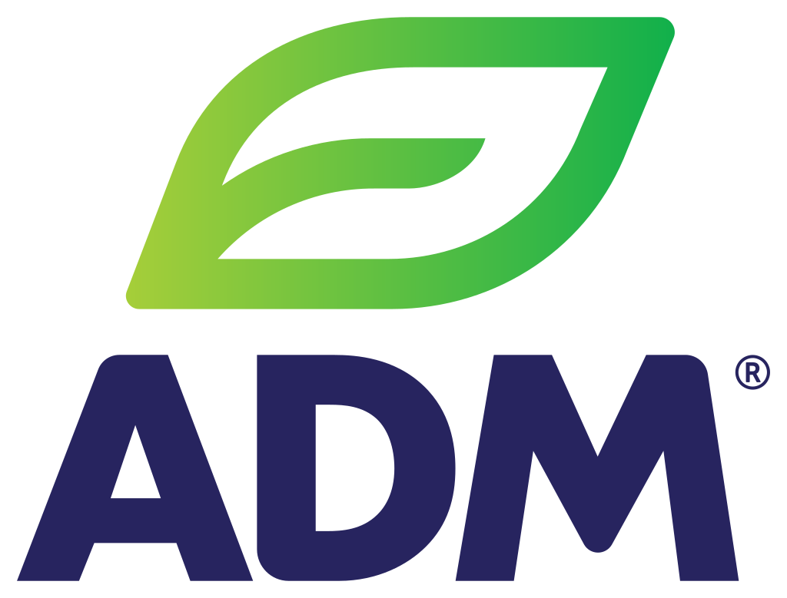

# Logos de empresas

Esta carpeta reúne los logos de las empresas que aparecen en los dashboards de Grafana.

Para usar un logo en un panel, abrí su archivo en GitHub y copiá la URL de la vista **Raw**. Cuando agregues una empresa, incluí su logo en esta carpeta y registrá la fuente en la tabla.

| Empresa | Logo | Archivo | URL para Grafana | Fuente |
|---|---|---|---|---|
| ADM |  | [adm.svg](./adm.svg) | [SVG directo](https://raw.githubusercontent.com/ParksIngDev/Grafana-Library/main/logos/adm.svg) | [Wikimedia Commons](https://commons.wikimedia.org/wiki/File:Archer_Daniels_Midland_logo.svg) |
| LDC (Lógico) |  | [ldc.svg](./ldc.svg) | [SVG directo](https://raw.githubusercontent.com/ParksIngDev/Grafana-Library/main/logos/ldc.svg) | — |

Cada marca pertenece a su respectivo titular.
